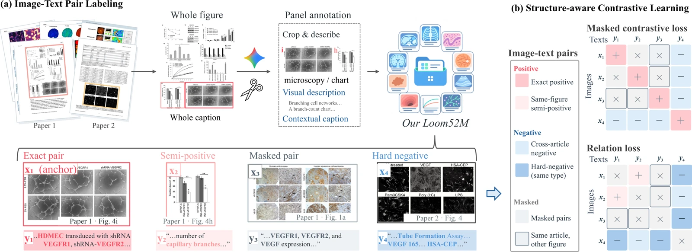
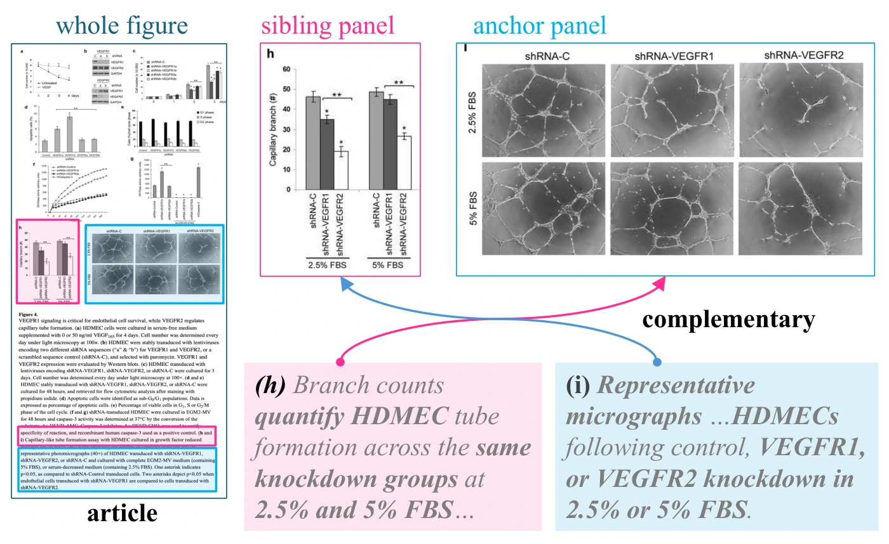
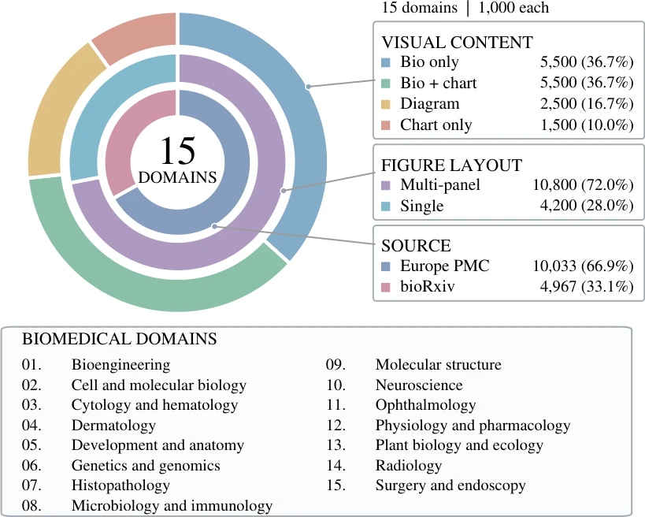
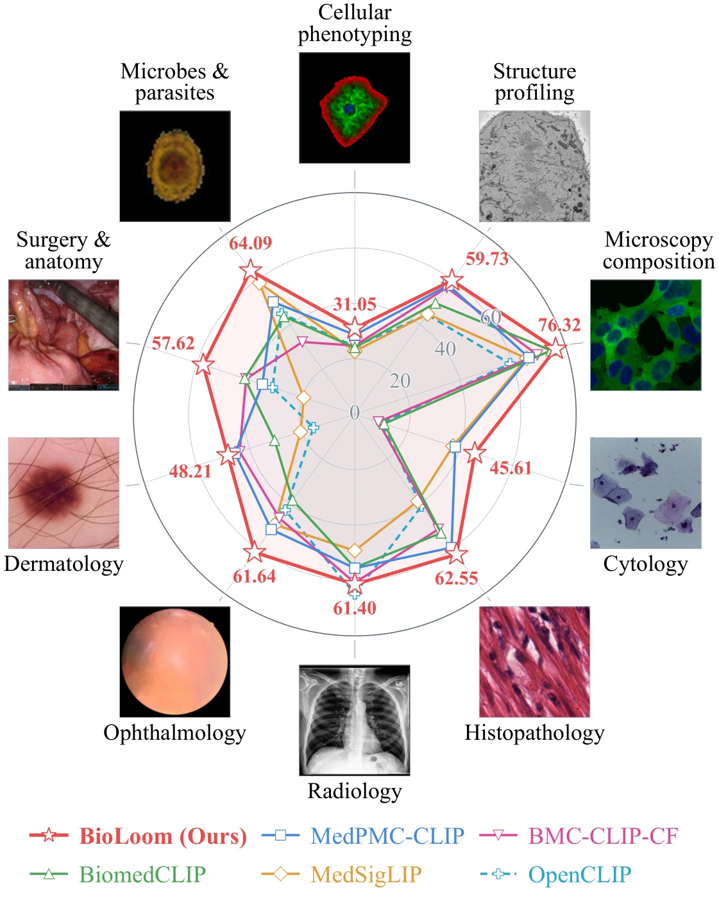

<h2 align="center"><picture><source media="(prefers-reduced-motion: reduce)" srcset="docs/figures/logo.png"></picture> </h2>
<h1 align="center">Scaling Biomedical Vision-Language Models by Learning from the Structure of Scientific Articles</h1>

<p align="center">
  <a href="https://scholar.google.com/citations?user=qyGKp0AAAAAJ">Yuwei Yang</a><sup>1,<a href="#-acknowledgments" aria-label="Acknowledgments">*</a></sup> ·
  <a href="https://xiaoxiaosun.com/">Xiaoxiao Sun</a><sup>2</sup> ·
  <a href="https://alejandro-lozano-dev.github.io/alejandro/">Alejandro Lozano</a><sup>2</sup> ·
  <a href="https://www.ysting.space/">Yuan-Sen Ting</a><sup>4</sup><br>
  <a href="https://scholar.google.com/citations?user=PzyvzksAAAAJ">Yuhui Yuan</a><sup>5</sup> ·
  <a href="https://zheng-lab-anu.github.io/">Liang Zheng</a><sup>1,3</sup> ·
  <a href="https://ai.stanford.edu/~syyeung/">Serena Yeung-Levy</a><sup>2</sup>
</p>

<p align="center">
<sup>1</sup> Australian National University (ANU) &nbsp;·&nbsp; <sup>2</sup> Stanford University<br>
<sup>3</sup> The University of Sydney &nbsp;·&nbsp; <sup>4</sup> The Ohio State University &nbsp;·&nbsp; <sup>5</sup> Canva
</p>

<p align="center">
  <a href="https://arxiv.org/abs/2611.33151"></a>
  <a href="https://huggingface.co/BioLoom"></a>
  <a href="https://huggingface.co/ChartFoundation/BioLoom-models"></a>
  <a href="https://huggingface.co/datasets/ChartFoundation/Loom52M"></a>
  <a href="https://huggingface.co/datasets/ChartFoundation/BioLoom-EvalSuite"></a>
</p>

<p align="center">🌐 <strong>Project Page</strong><br><a href="https://bioloom-clip.github.io/">https://bioloom-clip.github.io/</a></p>

> [!TIP]
> **Try BioLoom on your own data.** The [quick start](#use-bioloom) shows how to classify unlabeled images or evaluate retrieval on your image–caption pairs.
> DFN-2B is the default model.

<p align="center">
  
</p>
<p align="center"><em>Figure- and panel-level training pairs, with contrastive supervision drawn from their relationships in scientific articles.</em></p>

---

## 🔬 Overview

<details>
<summary><strong>Paper abstract</strong></summary>

The development of biomedical vision-language models (VLMs) with contrastive image-text pretraining has been driven by scaling to increasingly large and diverse image-text datasets. Beyond scaling, further progress can come from learning richer representations from existing data. We hypothesize that the structure of scientific literature itself provides an additional source of supervision: figures, panels, captions, and accompanying article text encode rich relationships across modalities. Yet, treating these as independent image-text pairs overlooks their relationships. To address this limitation, we incorporate these structural relationships into contrastive image-text supervision. We preserve exact image-text matches while introducing weaker positive supervision for related pairs, such as a panel and the caption of a sibling panel. We upweight cross-article negatives of the same content type to encourage finer discrimination. We also enrich panel descriptions using visual content, original figure captions, and mentioning paragraphs. Pairing panels with these descriptions and whole figures with their original captions yields **Loom52M**, a dataset of 52.4 million image-text pairs spanning scientific charts and biomedical images. Using Loom52M, **BioLoom** (DFN-2B) achieves 56.82% domain-balanced mean accuracy across 67 zero-shot classification tasks from 43 datasets in 10 domains, compared with 48.77% for MedPMC-CLIP. On BioLoomBench with concise captions and BioMedFlickr, it achieves bidirectional mean Recall@1 of 63.20% and 10.59%, versus 46.37% and 7.55% for the respective strongest evaluated baselines, BiomedCLIP and MedPMC-CLIP.

</details>

A microscopy panel shows what happened. A sibling chart can quantify it, while the caption and body text explain the experimental context. BioLoom uses those relationships to supervise biomedical image–text pretraining. The logo’s two interwoven ribbons form a B and reflect this connection between figures, panels, and text.

| Stage | What BioLoom learns from |
|:---|:---|
| **Construct image–text pairs** | A figure, its original caption, and relevant article passages ground panel crops, visual descriptions, and contextual captions. Whole figures are paired with their original captions. |
| **Use article structure during training** | Exact pairs receive the strongest alignment. A sibling panel’s caption supplies a weaker positive signal. Same-article cross-figure pairs are masked, and same-content-type pairs from different articles provide hard negatives. |

<p align="center">
  <a href="docs/figures/sibling-panels.webp"></a>
</p>
<p align="center"><em>A sibling chart quantifies tube formation under the conditions shown in the anchor microscopy panel.</em></p>

## 📦 Data and models

| Resource | What it contains |
|:---|:---|
| [Loom52M](https://huggingface.co/datasets/ChartFoundation/Loom52M) | **52,437,129** figure–text and panel–text pairs in hierarchical WebDataset shards. |
| [BioLoomBench](https://huggingface.co/datasets/ChartFoundation/BioLoom-EvalSuite/tree/main/bioloom-retrieval) | **15,000** figures across **15** biomedical domains, with concise and original captions. The main results use [`main-data/`](https://huggingface.co/datasets/ChartFoundation/BioLoom-EvalSuite/tree/main/bioloom-retrieval/main-data). Appendix I uses the [panel retrieval extension](https://huggingface.co/datasets/ChartFoundation/BioLoom-EvalSuite/tree/main/bioloom-retrieval/panel-retrieval). |
| [BioLoom Models](https://huggingface.co/ChartFoundation/BioLoom-models) | **Seven** model folders, each with OpenCLIP weights, configuration, and reference results. [Load a model](docs/evaluation.md). |

<p align="center">
  <a href="docs/figures/bioloombench-composition.webp"></a>
</p>
<p align="center"><em>Our BioLoomBench includes biological images, mixed image–chart figures, diagrams, and charts.</em></p>

## 📊 Evaluation

All scores are percentages. Bold and underlined values preserve the paper’s best and second-best markings among biomedical models. An asterisk marks random vision initialization for image–text pretraining. The diamond identifies the two BioLoom rows.

### Zero-shot classification

The [zero-shot benchmark](https://huggingface.co/datasets/ChartFoundation/BioLoom-EvalSuite/tree/main/zero-shot) covers 67 tasks from 43 sources across ten biomedical domains. Overall accuracy weights the domains equally after averaging tasks within each source, then sources within each domain.

<table>
<thead><tr><th scope="col">Model</th><th scope="col">Params.</th><th scope="col">Cell</th><th scope="col">Struct.</th><th scope="col">Micro.</th><th scope="col">Cytology</th><th scope="col">Histo.</th><th scope="col">Radiol.</th><th scope="col">Ophth.</th><th scope="col">Derm.</th><th scope="col">Surgery</th><th scope="col">Microb.</th><th scope="col">Overall</th></tr></thead>
<tbody>
<tr><th scope="row">Random</th><td align="right">-</td><td align="right">18.65</td><td align="right">17.78</td><td align="right">34.42</td><td align="right">13.77</td><td align="right">28.96</td><td align="right">38.18</td><td align="right">29.67</td><td align="right">13.23</td><td align="right">19.63</td><td align="right">29.23</td><td align="right">24.35</td></tr>
<tr><th scope="row">CoCa<sup>*</sup></th><td align="right">430M</td><td align="right">22.18</td><td align="right">33.45</td><td align="right">56.86</td><td align="right">41.56</td><td align="right">39.80</td><td align="right">36.31</td><td align="right">50.53</td><td align="right">17.37</td><td align="right">23.05</td><td align="right">31.48</td><td align="right">35.26</td></tr>
<tr><th scope="row">OpenCLIP<sup>*</sup></th><td align="right">428M</td><td align="right">24.49</td><td align="right">44.44</td><td align="right">59.04</td><td align="right">10.25</td><td align="right">41.03</td><td align="right">64.86</td><td align="right">42.80</td><td align="right">15.67</td><td align="right">31.26</td><td align="right">44.87</td><td align="right">37.87</td></tr>
<tr><th scope="row">PMC-CLIP<sup>*</sup></th><td align="right">137M</td><td align="right">28.16</td><td align="right">48.95</td><td align="right">69.20</td><td align="right">15.16</td><td align="right">57.30</td><td align="right">53.91</td><td align="right">38.74</td><td align="right">16.34</td><td align="right">29.09</td><td align="right">38.16</td><td align="right">39.50</td></tr>
<tr><th scope="row">MedSigLIP</th><td align="right">800M</td><td align="right">22.74</td><td align="right">44.77</td><td align="right">65.31</td><td align="right">37.28</td><td align="right">38.77</td><td align="right">49.26</td><td align="right">49.24</td><td align="right">20.62</td><td align="right">19.38</td><td align="right"><ins>58.58</ins></td><td align="right">40.59</td></tr>
<tr><th scope="row">BiomedCLIP</th><td align="right">196M</td><td align="right">24.11</td><td align="right">49.59</td><td align="right">74.55</td><td align="right">11.16</td><td align="right">53.02</td><td align="right">55.36</td><td align="right">38.27</td><td align="right">30.48</td><td align="right">41.83</td><td align="right">43.63</td><td align="right">42.20</td></tr>
<tr><th scope="row">Panel2Patch</th><td align="right">428M</td><td align="right">29.40</td><td align="right">47.12</td><td align="right">75.66</td><td align="right">9.50</td><td align="right">52.30</td><td align="right"><ins>63.31</ins></td><td align="right">47.56</td><td align="right">43.76</td><td align="right">37.34</td><td align="right">27.77</td><td align="right">43.37</td></tr>
<tr><th scope="row">BMC-CLIP-CF</th><td align="right">428M</td><td align="right">24.79</td><td align="right">56.53</td><td align="right">69.39</td><td align="right">8.97</td><td align="right">51.34</td><td align="right">60.85</td><td align="right">46.38</td><td align="right">43.76</td><td align="right">41.35</td><td align="right">32.25</td><td align="right">43.56</td></tr>
<tr><th scope="row">BMC-LongCLIP</th><td align="right">454M</td><td align="right">25.62</td><td align="right">51.49</td><td align="right">76.23</td><td align="right">35.61</td><td align="right">53.94</td><td align="right">60.73</td><td align="right">35.53</td><td align="right">40.87</td><td align="right">37.38</td><td align="right">28.62</td><td align="right">44.60</td></tr>
<tr><th scope="row">MedPMC-CLIP</th><td align="right">428M</td><td align="right">28.60</td><td align="right"><ins>57.60</ins></td><td align="right">66.17</td><td align="right"><ins>38.18</ins></td><td align="right">59.49</td><td align="right">55.57</td><td align="right">51.40</td><td align="right"><ins>45.49</ins></td><td align="right">35.11</td><td align="right">50.11</td><td align="right">48.77</td></tr>
<tr class="our-model"><th scope="row"><strong>◆ BioLoom (Scratch)<sup>*</sup></strong></th><td align="right">454M</td><td align="right"><strong>34.22</strong></td><td align="right">56.69</td><td align="right"><strong>79.70</strong></td><td align="right">37.96</td><td align="right"><ins>61.81</ins></td><td align="right"><strong>64.57</strong></td><td align="right"><ins>56.65</ins></td><td align="right">38.75</td><td align="right"><ins>52.65</ins></td><td align="right">45.90</td><td align="right"><ins>52.89</ins></td></tr>
<tr class="our-model"><th scope="row"><strong>◆ BioLoom (DFN-2B)</strong></th><td align="right">454M</td><td align="right"><ins>31.05</ins></td><td align="right"><strong>59.73</strong></td><td align="right"><ins>76.32</ins></td><td align="right"><strong>45.61</strong></td><td align="right"><strong>62.55</strong></td><td align="right">61.40</td><td align="right"><strong>61.64</strong></td><td align="right"><strong>48.21</strong></td><td align="right"><strong>57.62</strong></td><td align="right"><strong>64.09</strong></td><td align="right"><strong>56.82</strong></td></tr>
</tbody>
</table>

**Domains:** Cell = cellular phenotyping, Struct. = structure profiling, Micro. = microscopy composition, Histo. = histopathology, Radiol. = radiology, Ophth. = ophthalmology, Derm. = dermatology, Surgery = surgery and anatomy, Microb. = microbial and parasitic recognition.

<p align="center">
  <a href="docs/figures/zero-shot-domains.webp"></a>
</p>

### BioLoomBench retrieval

Recall at 1, 10, and 100 over the 15,000-figure gallery. I2T is image-to-text retrieval and T2I is text-to-image retrieval. To reproduce the main results, use the [`main-data/` shards](https://huggingface.co/datasets/ChartFoundation/BioLoom-EvalSuite/tree/main/bioloom-retrieval/main-data) and [`metadata.jsonl`](https://huggingface.co/datasets/ChartFoundation/BioLoom-EvalSuite/blob/main/bioloom-retrieval/metadata.jsonl).

<table>
<thead>
<tr><th scope="col" rowspan="3">Model</th><th scope="colgroup" colspan="6">Concise caption</th><th scope="colgroup" colspan="6">Original caption</th></tr>
<tr><th scope="colgroup" colspan="3">I2T</th><th scope="colgroup" colspan="3">T2I</th><th scope="colgroup" colspan="3">I2T</th><th scope="colgroup" colspan="3">T2I</th></tr>
<tr><th scope="col">R@1</th><th scope="col">R@10</th><th scope="col">R@100</th><th scope="col">R@1</th><th scope="col">R@10</th><th scope="col">R@100</th><th scope="col">R@1</th><th scope="col">R@10</th><th scope="col">R@100</th><th scope="col">R@1</th><th scope="col">R@10</th><th scope="col">R@100</th></tr>
</thead>
<tbody>
<tr><th scope="row">CoCa<sup>*</sup></th><td align="right">24.25</td><td align="right">46.37</td><td align="right">74.44</td><td align="right">22.35</td><td align="right">42.85</td><td align="right">71.15</td><td align="right">18.37</td><td align="right">36.88</td><td align="right">64.68</td><td align="right">18.53</td><td align="right">36.72</td><td align="right">62.48</td></tr>
<tr><th scope="row">OpenCLIP<sup>*</sup></th><td align="right">27.65</td><td align="right">50.47</td><td align="right">76.93</td><td align="right">25.69</td><td align="right">47.82</td><td align="right">75.24</td><td align="right">25.34</td><td align="right">47.37</td><td align="right">73.49</td><td align="right">24.68</td><td align="right">45.66</td><td align="right">71.75</td></tr>
<tr><th scope="row">PMC-CLIP<sup>*</sup></th><td align="right">4.75</td><td align="right">14.76</td><td align="right">33.11</td><td align="right">4.84</td><td align="right">15.87</td><td align="right">35.96</td><td align="right">4.47</td><td align="right">13.69</td><td align="right">30.34</td><td align="right">6.05</td><td align="right">18.04</td><td align="right">37.51</td></tr>
<tr><th scope="row">MedSigLIP</th><td align="right">27.39</td><td align="right">56.07</td><td align="right">82.69</td><td align="right">16.38</td><td align="right">38.63</td><td align="right">67.55</td><td align="right">19.88</td><td align="right">44.66</td><td align="right">72.75</td><td align="right">9.43</td><td align="right">26.52</td><td align="right">53.27</td></tr>
<tr><th scope="row">MedPMC-CLIP</th><td align="right">41.27</td><td align="right">70.51</td><td align="right">89.33</td><td align="right">36.84</td><td align="right">63.63</td><td align="right">84.71</td><td align="right">55.42</td><td align="right">80.70</td><td align="right">93.03</td><td align="right">56.14</td><td align="right">81.63</td><td align="right">93.35</td></tr>
<tr><th scope="row">Panel2Patch</th><td align="right">42.43</td><td align="right">71.55</td><td align="right">92.02</td><td align="right">36.96</td><td align="right">64.62</td><td align="right">87.45</td><td align="right">47.75</td><td align="right">74.83</td><td align="right">91.61</td><td align="right">49.57</td><td align="right">77.01</td><td align="right">92.84</td></tr>
<tr><th scope="row">BMC-LongCLIP</th><td align="right">44.39</td><td align="right">78.15</td><td align="right">95.83</td><td align="right">35.47</td><td align="right">68.14</td><td align="right">90.77</td><td align="right">67.35</td><td align="right">87.45</td><td align="right">95.83</td><td align="right">67.17</td><td align="right">87.65</td><td align="right">95.90</td></tr>
<tr><th scope="row">BMC-CLIP-CF</th><td align="right">47.11</td><td align="right">76.90</td><td align="right">94.85</td><td align="right">38.74</td><td align="right">66.15</td><td align="right">88.41</td><td align="right">52.09</td><td align="right">78.96</td><td align="right">92.94</td><td align="right">51.89</td><td align="right">78.97</td><td align="right">93.25</td></tr>
<tr><th scope="row">BiomedCLIP</th><td align="right">51.65</td><td align="right">84.38</td><td align="right">97.67</td><td align="right">41.09</td><td align="right">75.63</td><td align="right">94.71</td><td align="right">69.80</td><td align="right">89.67</td><td align="right">97.11</td><td align="right">69.11</td><td align="right">89.48</td><td align="right">96.97</td></tr>
<tr class="our-model"><th scope="row"><strong>◆ BioLoom (Scratch)<sup>*</sup></strong></th><td align="right"><ins>61.93</ins></td><td align="right"><ins>90.61</ins></td><td align="right"><ins>98.79</ins></td><td align="right"><ins>52.33</ins></td><td align="right"><ins>83.86</ins></td><td align="right"><ins>97.44</ins></td><td align="right"><ins>75.91</ins></td><td align="right"><ins>92.94</ins></td><td align="right"><ins>98.09</ins></td><td align="right"><ins>74.22</ins></td><td align="right"><ins>91.52</ins></td><td align="right"><ins>97.43</ins></td></tr>
<tr class="our-model"><th scope="row"><strong>◆ BioLoom (DFN-2B)</strong></th><td align="right"><strong>66.81</strong></td><td align="right"><strong>92.81</strong></td><td align="right"><strong>99.28</strong></td><td align="right"><strong>59.59</strong></td><td align="right"><strong>88.81</strong></td><td align="right"><strong>98.77</strong></td><td align="right"><strong>79.29</strong></td><td align="right"><strong>94.57</strong></td><td align="right"><strong>98.39</strong></td><td align="right"><strong>78.34</strong></td><td align="right"><strong>94.10</strong></td><td align="right"><strong>98.41</strong></td></tr>
</tbody>
</table>

### BioMedFlickr retrieval

We report Recall at 1, 10, and 100 over the [7,185 BioMedFlickr image–caption pairs](https://huggingface.co/datasets/ChartFoundation/BioLoom-EvalSuite/tree/main/biomedflickr-retrieval). The table uses the paper’s same-caption relevance protocol. The release also includes the exact-pair protocol.

<table>
<thead>
<tr><th scope="col" rowspan="2">Model</th><th scope="colgroup" colspan="3">Image to text</th><th scope="colgroup" colspan="3">Text to image</th></tr>
<tr><th scope="col">R@1</th><th scope="col">R@10</th><th scope="col">R@100</th><th scope="col">R@1</th><th scope="col">R@10</th><th scope="col">R@100</th></tr>
</thead>
<tbody>
<tr><th scope="row">CoCa<sup>*</sup></th><td align="right">1.64</td><td align="right">5.58</td><td align="right">15.30</td><td align="right">2.06</td><td align="right">7.95</td><td align="right">23.98</td></tr>
<tr><th scope="row">OpenCLIP<sup>*</sup></th><td align="right">2.41</td><td align="right">8.48</td><td align="right">23.42</td><td align="right">3.13</td><td align="right">11.36</td><td align="right">34.25</td></tr>
<tr><th scope="row">PMC-CLIP<sup>*</sup></th><td align="right">2.03</td><td align="right">8.38</td><td align="right">25.61</td><td align="right">2.67</td><td align="right">11.75</td><td align="right">34.38</td></tr>
<tr><th scope="row">MedSigLIP</th><td align="right">3.56</td><td align="right">10.83</td><td align="right">31.45</td><td align="right">4.62</td><td align="right">15.18</td><td align="right">38.78</td></tr>
<tr><th scope="row">BiomedCLIP</th><td align="right">4.76</td><td align="right">14.04</td><td align="right">35.46</td><td align="right">4.68</td><td align="right">19.05</td><td align="right">50.45</td></tr>
<tr><th scope="row">Panel2Patch</th><td align="right">3.60</td><td align="right">12.40</td><td align="right">33.00</td><td align="right">7.00</td><td align="right">19.82</td><td align="right">46.93</td></tr>
<tr><th scope="row">BMC-LongCLIP</th><td align="right">5.00</td><td align="right">15.57</td><td align="right">37.52</td><td align="right">6.67</td><td align="right">20.97</td><td align="right">52.32</td></tr>
<tr><th scope="row">BMC-CLIP-CF</th><td align="right">4.86</td><td align="right">14.18</td><td align="right">35.81</td><td align="right">6.99</td><td align="right">22.95</td><td align="right">50.47</td></tr>
<tr><th scope="row">MedPMC-CLIP</th><td align="right">5.94</td><td align="right">19.94</td><td align="right">45.26</td><td align="right"><ins>9.16</ins></td><td align="right"><ins>31.61</ins></td><td align="right"><ins>61.38</ins></td></tr>
<tr class="our-model"><th scope="row"><strong>◆ BioLoom (Scratch)<sup>*</sup></strong></th><td align="right"><ins>8.00</ins></td><td align="right"><ins>21.85</ins></td><td align="right"><ins>45.66</ins></td><td align="right">8.84</td><td align="right">27.63</td><td align="right">58.75</td></tr>
<tr class="our-model"><th scope="row"><strong>◆ BioLoom (DFN-2B)</strong></th><td align="right"><strong>9.73</strong></td><td align="right"><strong>25.58</strong></td><td align="right"><strong>49.46</strong></td><td align="right"><strong>11.45</strong></td><td align="right"><strong>31.90</strong></td><td align="right"><strong>63.51</strong></td></tr>
</tbody>
</table>

## 🛠️ Reproduce the workflow

The BioLoom code is licensed under the [MIT License](LICENSE).

<p>
  <a href="#annotation">🖼️ Annotate panels</a> &nbsp;·&nbsp;
  <a href="#environment">⚙️ Set up the environment</a> &nbsp;·&nbsp;
  <a href="#use-bioloom">⚡ Use BioLoom on your own task</a><br>
  <a href="#training">🚀 Train a model</a> &nbsp;·&nbsp;
  <a href="#evaluation">🎯 Evaluate a checkpoint</a>
</p>

<a name="annotation"></a>

### 🖼️ Annotate panels

BioLoom uses **Gemini 3.5 Flash-Lite** (`gemini-3.5-flash-lite`) for panel annotation. Prepare a JSONL manifest with a stable figure ID, image path, original figure caption, and up to two passages that mention the figure. The [production prompt and schema](annotation/schema.py) return a normalized bounding box, content type, modality, visual description, and context-enriched caption for each panel. See the [annotation guide](docs/annotation.md) for the input format and how to resume a run.

After installing the environment below, create a [Gemini Developer API key](https://aistudio.google.com/apikey) and run:

```bash
export GEMINI_API_KEY="your-api-key"
python annotation/annotate.py figures.jsonl annotations.jsonl --workers 8
python annotation/crop.py figures.jsonl annotations.jsonl panels
```

<a name="environment"></a>

### ⚙️ Set up the environment

Use Python 3.10 or 3.11. Install a matching CUDA build of PyTorch and torchvision before setting up the remaining dependencies for GPU runs.

```bash
git clone https://github.com/yuweiyang-anu/BioLoom.git
cd BioLoom
python -m venv .venv
source .venv/bin/activate
python -m pip install --upgrade pip
python -m pip install -r requirements.txt
export PYTHONPATH="$PWD/src${PYTHONPATH:+:$PYTHONPATH}"
```

<a name="use-bioloom"></a>

### ⚡ Use BioLoom on your own task

These commands load **BioLoom (DFN-2B)** from Hugging Face. Add `--model scratch` to use **BioLoom (Scratch)** or `--device cpu` to run without a GPU.

#### Zero-shot classification

Provide image paths and descriptions of the candidate classes. Each class can have one description or several. Prediction works with unlabeled images and saves a `predicted_label` for each image.

```bash
python -m evaluation.custom --mode predict \
  --task classification.json --output results/my-predictions.json
```

<details>
<summary>Example classification.json</summary>

Image paths are relative to the JSON file.

```json
{
  "classes": {
    "normal": "A chest radiograph with normal lungs.",
    "pneumonia": "A chest radiograph showing pneumonia."
  },
  "samples": [
    {"image": "images/example-01.png"},
    {"image": "images/example-02.png"}
  ]
}
```

</details>

<details>
<summary>Score predictions against known labels</summary>

Add a `label` matching a key in `classes` to each sample, such as `{"image": "images/example-01.png", "label": "normal"}`. Run evaluation to save accuracy, macro-F1, AUC, and sample count.

```bash
python -m evaluation.custom --mode zero-shot \
  --task classification.json --output results/my-classification.json
```

</details>

#### Image–text retrieval

Provide your images and their matching captions. The output reports R@1, R@10, and R@100 for image-to-text and text-to-image retrieval.

```bash
python -m evaluation.custom --mode retrieval \
  --task retrieval.json --output results/my-retrieval.json
```

<details>
<summary>Example retrieval.json</summary>

Each image–caption pair defines a match. All pairs form the retrieval gallery.

```json
{
  "samples": [
    {"image": "figures/figure-01.png", "caption": "Fluorescence microscopy showing endothelial tube formation."},
    {"image": "figures/figure-02.png", "caption": "A bar chart of capillary branch counts across conditions."}
  ]
}
```

</details>

<a name="training"></a>

### 🚀 Train a model

All recipes use the released Loom52M training split and a pretrained BioClinical ModernBERT text encoder. The defaults are **8 GPUs × 192 samples**, **10 epochs**, a **0.05 relation-loss weight**, and a **1.1 same-content-type hard-negative weight**.

Download the training shards once:

```bash
hf download ChartFoundation/Loom52M --repo-type dataset \
  --include 'train/*.tar' 'dataset_stats.json' --local-dir data/Loom52M
```

**Main paper models**

```bash
# Randomly initialized ViT-L/14 vision encoder
python -m training.train --variant scratch --data data/Loom52M/train

# DFN-2B initialized ViT-L/14 vision encoder
python -m training.train --variant dfn2b --data data/Loom52M/train
```

**Model sizes**

```bash
python -m training.train --variant vit-s --data data/Loom52M/train
python -m training.train --variant vit-b --data data/Loom52M/train
python -m training.train --variant vit-h --data data/Loom52M/train
```

**Additional vision initializations**

```bash
python -m training.train --variant dinov2 --data data/Loom52M/train

python -m training.commonpool --output data/commonpool-visual.pt
python -m training.train --variant commonpool --data data/Loom52M/train \
  --vision-checkpoint data/commonpool-visual.pt
```

Use `--dry-run` to see the launch command and `--resume path/to/checkpoint.pt` to resume a training run. See the [training guide](docs/training.md) for learning rates and checkpoint layout.

<a name="evaluation"></a>

### 🎯 Evaluate a checkpoint

The evaluator loads the released weights for the selected model. With `--download`, it also fetches the requested benchmark. To reuse data already on disk, pass `--data path/to/BioLoom-EvalSuite`.

**Main paper evaluations**

```bash
# All 67 zero-shot classification tasks from 43 sources
python -m evaluation --model dfn2b --benchmark zero-shot --download \
  --output results/dfn2b-zero-shot.json

# BioLoomBench, including the domain and visual-content breakdowns
python -m evaluation --model dfn2b --benchmark bioloombench --groups --download \
  --output results/dfn2b-bioloombench.json

# BioMedFlickr, with both same-caption and exact-pair relevance
python -m evaluation --model dfn2b --benchmark biomedflickr --download \
  --output results/dfn2b-biomedflickr.json
```

**Panel retrieval, quick check, and reported results**

```bash
# Appendix I, panel-level and cross-level retrieval
python -m evaluation --model dfn2b --benchmark panel-retrieval --download \
  --output results/dfn2b-panel-retrieval.json

# Evaluate one source before running the full zero-shot suite
python -m evaluation --model vit-s --benchmark zero-shot --dataset octmnist --download \
  --output results/vit-s-octmnist.json

# Download the reported scores for comparison (no inference)
python -m evaluation --model dfn2b --benchmark zero-shot --reference \
  --output results/dfn2b-zero-shot-reference.json
```

**Evaluate all released variants on one benchmark**

```bash
for model in scratch dfn2b dinov2 commonpool vit-s vit-b vit-h; do
  python -m evaluation --model "$model" --benchmark bioloombench --download \
    --output "results/$model-bioloombench.json"
done
```

Use `--checkpoint path/to/weights.pt` for local weights and choose the corresponding architecture with `--model`. See the [evaluation guide](docs/evaluation.md) for the input paths, metrics, and result formats.

## 🙏 Acknowledgments

BioLoom builds on [OpenCLIP](https://github.com/mlfoundations/open_clip) under its [original license](src/LICENSE). Loom52M uses the scientific figure records released by [BIOMEDICA](https://huggingface.co/BIOMEDICA). We thank the authors and maintainers of these projects, the published model initializations, and the [evaluation datasets](https://huggingface.co/datasets/ChartFoundation/BioLoom-EvalSuite/blob/main/zero-shot/SOURCES.md).

\* Work done as a visiting PhD student on site with [MARVL, the Medical AI and Computer Vision Lab](https://marvl.stanford.edu/) at Stanford University. Thanks to Serena Yeung-Levy and the lab members for their hospitality and helpful discussions! 🎉

## 📝 Citation

```bibtex
@misc{yang2026bioloom,
  title         = {BioLoom: Scaling Biomedical Vision-Language Models by Learning from the Structure of Scientific Articles},
  author        = {Yang, Yuwei and Sun, Xiaoxiao and Lozano, Alejandro and Ting, Yuan-Sen and Yuan, Yuhui and Zheng, Liang and Yeung-Levy, Serena},
  year          = {2026},
  eprint        = {2611.33151},
  archivePrefix = {arXiv},
  url           = {https://arxiv.org/abs/2611.33151}
}
```
